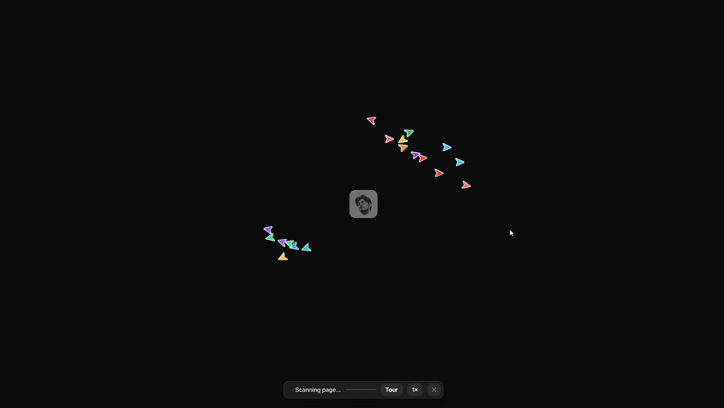

# Swarm Cursors: a Claude skill

Tell Claude **"add the swarm effect to my homepage"** and it wires up a page that wipes to a
blank canvas, then rebuilds itself live with a swarm of multiplayer cursors: crosshair-drawn
boxes, typed text, pen-tool lines, ruler guides and alt-drag duplicates, with synthesized
keyboard and piano sounds.



> **Credit.** The effect is **[Joel Califa's Swarm](https://califa.github.io/swarm-site/)**: the
> cursor set, the flocking physics, the build choreography and the look are his. This project is a
> tribute that points his idea at *any* page. See [CREDITS.md](CREDITS.md). 

## What it is

A [Claude skill](https://www.claude.com/docs/skills/how-to) (a folder of instructions plus scripts
that Claude loads when relevant). The skill knows how to:

- add the effect to one page or a whole site, as a floating **Rebuild this page** button, an
  auto-play intro, a hotkey, a `?swarm` link, or any element you mark with `data-swarm-trigger`
- restrict it to chosen pages, exclude elements (cookie banners, chat widgets) and remove it cleanly
- place it correctly for plain HTML, Vite/CRA/Astro/SvelteKit/Hugo/Jekyll, Next.js, WordPress,
  Shopify and hosted builders ([guide](swarm-cursors/references/platforms.md))
- run a headless-browser check that the install actually works

The effect overlays your page and leaves the real DOM untouched, so SEO, forms and analytics keep
working underneath. It is one dependency-free file (157 KB, about 44 KB gzipped), loaded with `defer`, and it sends
nothing to any server.

## Install the skill

**Claude.ai (web or desktop).**
1. Settings, Capabilities: turn on **Code execution and file creation**.
2. Download `swarm-cursors.zip` from the [Releases](../../releases) page (or run
   `scripts/build-release.sh` to build it).
3. Customize, Skills, then upload the zip and switch the skill on. (Menu names change; see
   Anthropic's [Skills docs](https://www.claude.com/docs/skills/how-to) if yours differ.)

**Claude Code.** Copy the folder into your skills directory:

```bash
cp -r swarm-cursors ~/.claude/skills/        # all projects
# or: cp -r swarm-cursors .claude/skills/    # this project only
```

Then run `/skills` to confirm it is listed. Skills installed in one place do not sync to the others.

In Claude Code, Claude edits your real project files. In claude.ai, upload or paste your page and
it returns the edited files plus `swarm-cursors.js` to put on your host.

## Use it

Just ask:

- "Add the swarm effect to my homepage only."
- "Put it on every page and play it automatically on load."
- "Use my own button instead of the floating one."
- "Keep the cookie banner out of the rebuild."
- "Remove it."

## Use it without Claude

The skill's pieces work on their own:

```bash
# one page, floating button
python swarm-cursors/scripts/install.py site/index.html

# auto-play 1.5s after load, once per browser session
python swarm-cursors/scripts/install.py site/index.html --trigger auto --delay 1500 --once session

# undo (leaves the file byte-identical to before)
python swarm-cursors/scripts/install.py site/index.html --remove
```

Or add the tag by hand:

```html
<script src="swarm-cursors.js" defer data-trigger="button" data-position="bottom-right"></script>
```

| Option | Values | Default |
| --- | --- | --- |
| `data-trigger` | `button`, `auto`, `none` | `button` |
| `data-label` | button text | `Rebuild this page` |
| `data-position` | `bottom-right`, `bottom-left`, `top-right`, `top-left` | `bottom-right` |
| `data-hotkey` | e.g. `alt+shift+s`, or empty to disable | `alt+shift+s` |
| `data-delay` | ms before `auto` fires | `800` |
| `data-once` | `session` = auto-play once per browser session | every load |
| `data-paths` | e.g. `/,/about,/blog/*` | all pages the script is on |
| `data-reduced-motion` | `skip` (auto does nothing for people who prefer reduced motion), `ignore` | `skip` |

Always available: the hotkey, `?swarm` in the URL, `[data-swarm-trigger]`, `<a href="#swarm">`,
and `data-swarm-ignore` on anything the rebuild should skip. Page API:
`SwarmCursors.start()`, `.stop(true)`, `.isRunning()`, plus `swarm:start` / `swarm:exit` events.

Try it locally: open [`examples/index.html`](examples/index.html) and click the button.

## Limits

- WebGL canvases, playing video and cross-origin iframes (maps, YouTube) become gray placeholders.
  The Chrome extension can screenshot them; a page script cannot.
- It is a visual rebuild. Animations freeze at the moment of the click. Pages over about 4,000 layers or
  40,000px tall are capped.
- A Content-Security-Policy with `style-src` lacking `'unsafe-inline'` blocks it. The script detects this,
  never shows the button, and logs a console warning, so visitors keep the normal page.
- Built for desktop pointers. It runs on phones, but is meant for a mouse.
- Audio stays locked until the visitor clicks once; M mutes.

## What was tested

In headless Chromium: button, auto, hotkey, `?swarm`, `#swarm` link, per-page paths, `data-swarm-ignore`
(with a control), reduced-motion, double-loading, a phone viewport, an inner-scrolling app page, strict and
permissive CSP, and exit paths (the page DOM was identical afterwards). The installer was tested for
idempotence, nested folders, CRLF files and byte-exact removal. **Not tested on the real platforms:** the
Next.js, WordPress, Shopify and hosted-builder recipes in
[`references/platforms.md`](swarm-cursors/references/platforms.md) are standard patterns, so run
`python swarm-cursors/scripts/verify.py <url>` against your own site.

## Related

The browser-extension version, which works on any site you visit, lives at
[DhvanilPatel/swarm-cursors](https://github.com/DhvanilPatel/swarm-cursors).

## Credit and license

See [CREDITS.md](CREDITS.md).

<!-- TODO before making this repo public: replace this line with the chosen license
     (and add a LICENSE file) once Joel Califa has agreed, e.g.
     "Released under the MIT License, with Joel Califa's permission (see CREDITS.md)." -->
**License: pending.** This project adapts parts of Swarm, which has no license of its own, so no license is
granted here until Joel Califa's permission is recorded in [CREDITS.md](CREDITS.md).
